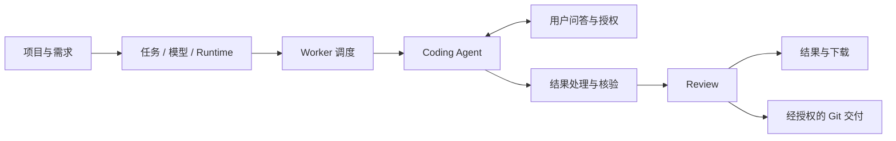

# Seven Agent Force

### 一支可编排的 Coding Agent 军团。

**把不同的 Coding Agent 组织起来，让开发任务从需求走向可检查、可交付的结果。**

Seven Agent Force 是一个可自托管的 Agent 开发任务平台。你可以在项目中提出需求，为任务选择模型与执行环境，由 Worker 调度和运行 Coding Agent，在网页中查看进度、回答问题、处理授权，再检查结果、完成 Review，并按批准的策略交付到 Git 仓库。

> **项目正在积极开发和演进中。** 当前面向开发探索、二次开发和受控自托管验证，接口、配置及部署方式可能调整。生产使用前需要在自己的环境中完成安全、运行时和业务验证。

*An orchestrated force of coding agents — self-hosted task execution, human interaction, review, and controlled delivery. Actively evolving.*

## 为什么是 Force

一个 Coding Agent 能处理一段任务；一支 Agent 军团还需要统一的项目上下文、执行环境、调度、权限、进度、检查和交付流程。

Seven Agent Force 把这些能力放到一个控制面中：

- **项目提供上下文**：代码来源、执行要求和完成规则随任务带入。
- **Runtime 定义执行方式**：任务绑定已发布的执行环境，Worker 根据能力与兼容性执行。
- **Adapter 连接不同 Agent**：将原生 Agent 的启动、事件、问题、中断和会话恢复映射到统一协议。
- **人参与关键决定**：回答澄清问题、补充信息，以及处理需要明确批准的操作。
- **结果经过平台核验**：执行结束后还有结果处理、独立 Review 和交付状态。

目前仓库提供 **Codex、Claude Adapter** 及用于合成验证的 **Fake Adapter**。其他 Coding Agent 可以通过 Runtime SDK 和 Adapter 协议扩展接入。

## 一条任务如何完成



每个任务保留它所绑定的执行输入和 Runtime 身份。任务执行、Review 和 Git 交付各自记录状态，便于判断当前进度、等待谁处理，以及失败发生在哪个环节。

## 当前能力

| 领域 | 能力 |
| --- | --- |
| 项目与任务 | 项目上下文、任务提交、模型与 Runtime 选择、状态与事件查询 |
| Worker 执行 | 容器执行环境、Worker 能力与容量调度、运行控制、资源记录与恢复机制 |
| 人机协作 | Agent 提问、用户回答与补充、操作授权、取消与恢复相关生命周期 |
| 结果与 Review | 结果处理合同、平台独立核验、输出归档与下载、独立审查 |
| Git 交付 | 经授权的分支交付与 Draft PR/MR 创建，独立跟踪交付状态 |
| 外部接入 | Application API Key、Open REST、MCP 工具、SSE 与 Webhook |
| 扩展开发 | Python Runtime SDK、Adapter 协议、Result Processor 和执行 Hook |
| 操作控制台 | React Web 界面，复用登录、组织、权限、菜单和管理基础能力 |

具体支持范围、方法、参数、参数类型和限制以 [协议文档](docs/workforce/protocols/README.md) 为准。源码和本地测试验证的能力，还需要结合实际 Provider、镜像、Worker 主机及 Git 服务配置进行集成验证。

## 设计边界

- Agent 的完成输出形成待核验提案，由平台在 Harness 之外独立检查结果、文件和哈希。
- Application、用户、Worker 和 Attempt 使用各自的身份与授权边界。
- 结果打包、Review 和 Delivery 的重试不重新执行 Agent。
- Attempt 容器不开放控制 HTTP/gRPC 端口，也不接收 Control Plane 的 Docker socket。
- 生产 Runtime 使用不可变镜像引用；外部网络和 Git 交付遵循明确授权。

参见 [架构与信任合同](docs/workforce/architecture-and-contracts.md)。

## 从源码开始

### 环境

- Go **1.26.10**（以 `go.mod` / `go.work` 为准）
- Node.js **20.19+**、pnpm **10**
- Python **3.11+**（Runtime SDK、文档及发布检查）

```sh
git clone https://github.com/CaixyPromise/seven-agent-force.git
cd seven-agent-force
make web-install
make check
```

以上执行源码检查与 Web 构建。完整任务流还需要配置 PostgreSQL、Redis、RabbitMQ、对象存储、独立 Linux Docker Worker、兼容 Runtime 和模型 Provider。配置示例默认关闭多项外部集成，不包含可直接使用的业务凭据。

运行和部署步骤见 [配置说明](docs/configuration.md)、[部署指南](docs/deployment.md) 和 [二次开发指南](docs/development.md)。Web 开发默认地址为 `http://127.0.0.1:5177`，默认 API 代理目标为 `http://127.0.0.1:9277`。

## 文档与开发入口

| 你想做什么 | 从这里开始 |
| --- | --- |
| 理解系统架构 | [架构入口](docs/architecture.md) · [组件职责与信任边界](docs/workforce/architecture-and-contracts.md) |
| 修改 Server / Web 业务 | [二次开发指南](docs/development.md) |
| 写 Adapter 或修改 SDK | [SDK 开发指南](docs/sdk-development.md) · [Adapter 开发与镜像接入](docs/workforce/agent-adapter-developer-guide.md) |
| 查 SDK 方法、参数和类型 | [Python SDK 参考](docs/workforce/protocols/python-sdk.md) · [Adapter 接口参考](docs/workforce/agent-adapter-interface-reference.md) |
| 从外部系统提交任务 | [Open REST](docs/workforce/protocols/open-rest.md) · [MCP](docs/workforce/protocols/mcp.md) |
| 编写结果处理器 | [Result Processor](docs/workforce/protocols/result-processor.md) |
| 配置和运维 | [配置](docs/configuration.md) · [部署](docs/deployment.md) · [技术文档导航](docs/workforce/README.md) |

可运行的 [本地 SDK 示例](docs/examples/sdk/local_adapter.py) 使用合成输入，不调用真实模型。

项目也附带两个 AI 开发 Skill：

- [seven-force-development](.agents/skills/seven-force-development/SKILL.md)：Server / Web 二次开发。
- [seven-force-sdk-development](.agents/skills/seven-force-sdk-development/SKILL.md)：SDK / Adapter / Processor 开发。

## 仓库结构

```text
.agents/skills/                 项目开发 Skill
seven-agent-force-server/       Go API、Worker、CLI、MCP 与基础设施
seven-agent-force-web/          React 操作控制台
deploy/workforce/               Adapters、Python SDK、镜像与部署资源
docs/                          架构、开发、协议和部署文档
scripts/                       检查与发布工具
third_party/                   依赖许可证及原始归属证据
```

现有 `/workforce` 路由和协议标识保留，Python SDK 使用 `seven_agent.force` 导入路径。

## 参与开发

欢迎围绕 Agent 接入、协议兼容、执行可靠性、开发体验和文档提出 Issue 或 Pull Request。提交前阅读 [CONTRIBUTING.md](CONTRIBUTING.md)，说明要解决的具体问题、行为变化、验证方法及已知限制。

安全问题请使用 [私密漏洞报告](https://github.com/CaixyPromise/seven-agent-force/security/advisories/new)，不要公开发布凭据或可利用细节。详见 [安全策略](SECURITY.md)。

## 许可证与归属

项目使用 [Apache License 2.0](LICENSE)。基础能力源自 Seven Framework，归属说明见 [NOTICE](NOTICE)。第三方依赖遵循各自许可证，原始证据及说明见 [THIRD_PARTY_NOTICES.md](THIRD_PARTY_NOTICES.md) 和 `third_party/`。
